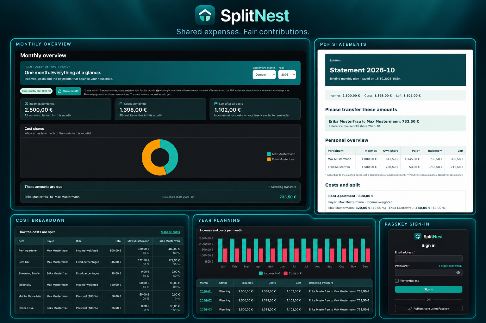

<p align="center">
  
</p>

<h1 align="center">SplitNest</h1>

<p align="center">
  <b>Shared expenses. Fair contributions.</b><br>
  Household budgeting, cost splitting and monthly PDF statements for shared homes.
</p>

<p align="center">
  
  <a href="https://github.com/triopsi/SplitNest/actions/workflows/tests.yml"></a>
  <a href="https://github.com/triopsi/SplitNest/actions/workflows/build.yml"></a>
  <a href="https://github.com/triopsi/SplitNest/releases"></a>
</p>

SplitNest helps shared households split expenses fairly, track their budget and create monthly statements. Available in English and German, with passwordless sign-in using passkeys.

[](.github/assets/splitnest-preview.png)

[Quick start](#quick-start) · [Budgets & transfers](#budgets-reimbursements-and-planned-transfers) · [Monthly statements](#personal-monthly-statements) · [HTTPS & reverse proxy](#https--reverse-proxy) · [Updates](#updates) · [User management](#user-management-from-the-console) · [Backups](#backups) · [Development](#development)

## Quick start

You need [Docker with Docker Compose](https://docs.docker.com/get-started/get-docker/).

**1. Create a folder for SplitNest and save this as `compose.yaml`:**

```yaml
services:
  app:
    image: triopsi/splitnest:latest
    restart: unless-stopped
    ports:
      - "127.0.0.1:8080:8080"
    environment:
      APP_URL: http://localhost:8080
      DB_CONNECTION: sqlite
      DB_DATABASE: /var/www/html/storage/database.sqlite
      AUTO_MIGRATE: "true"
      QUEUE_CONNECTION: sync
      SESSION_SECURE_COOKIE: "false"
      LOG_CHANNEL: stderr
    volumes:
      - storage:/var/www/html/storage

volumes:
  storage:
```

**2. Start SplitNest in that folder:**

```sh
docker compose up -d
```

**3. Open [localhost:8080/admin](http://localhost:8080/admin) and create your administrator account.**

That's it. The container creates its encryption key and SQLite database automatically and runs database migrations on startup. Both are kept in the `storage` volume across restarts and updates. No repository clone, local PHP, Node.js or `.env` file is needed.

The example is for a local HTTP setup. For a server or passkeys, continue with HTTPS below. The same Compose file is also available as [compose.production.yaml](compose.production.yaml).

## What you can do

- **Split expenses fairly** — equal shares, fixed percentages, income-based shares or personal expenses.
- **Separate salary from other receipts** — choose which incomes determine income-based cost shares.
- **Reserve money for a purpose** — budgets fund related bills and carry unspent money forward.
- **Apply reimbursements** — link a contribution to a bill before its remaining cost is split.
- **See who owes whom** — household balancing plus explicitly planned forwarding payments and external contributions.
- **Plan recurring costs** — one-off expenses and recurring schedules, with a year overview and charts. Schedule price changes from a month without duplicating the bill.
- **Close a month** — save a snapshot, generate a PDF statement and send it by e-mail. Reopen a month when something needs correcting.
- **Limit a participant's statement** — send only their own cost shares, contributions and directly involving transfers.
- **Arrange your dashboard** — move, resize or hide widgets, including monthly budget balances; layouts are saved per user.
- **Manage your household** — invite users by e-mail, archive departed participants from a chosen month and manage accounts as an administrator.
- **Sign in with passkeys** — register a passkey on your profile for passwordless login over HTTPS or localhost.
- **Keep a backup** — export and restore durable application data, including accounts, settings and budgets.
- **Choose your language** — switch between English and German in the topbar.

## Budgets, reimbursements and planned transfers

Under **Incomes**, enable **Include in cost allocation income** for net salary. Disable it for receipts that should not change income-based cost shares, such as child benefit or subscription contributions. These amounts still count as receipts. **Recipient** identifies the person who receives and uses the money in the plan; it does not imply a payment from another participant.

A **budget** is a virtual pool for a purpose, not a separate bank account or a spending limit. Create a budget and assign both receipts and related expenses to it. Assigned receipts are excluded from allocation income automatically. For example, €353 of earmarked receipts cover €300 of related bills and leave €53 reserved for later months. If the bills total €400, only the uncovered €47 uses the selected cost-splitting rule. Money remains on the recipients' accounts; the calculation tracks who holds it. Bills draw on a budget in creation order.

For a **reimbursement**, record the receipt under Incomes and select the original bill under **Reimbursement for**. Keep the full amount on the bill: a €20 bill and a €4.99 reimbursement leave €15.01 to split. Reimbursements are applied before budget funds, then any remainder is split. The receipt and bill must be due in the same month, and reimbursements cannot exceed the bill. Each receipt can fund either a budget or a reimbursement.

To plan a forwarded subsidy or external contribution, choose a **household payer** or enter an **external payer**, select the final recipient and enable **Also show this payment in the transfer plan**. Record forwarded money only once at its final recipient and exclude it from the forwarding person's net salary. Payments with the same payer and recipient are grouped, with their components shown separately. Leave the option disabled for payments handled separately. The plan shows expected payments, not confirmed bank transactions; the option applies to every scheduled occurrence.

The **Budget balances for this month** dashboard widget shows carryovers, receipts, spending and remaining reserves. Open months are projections; closing a month freezes its amounts. To correct earlier months, reopen later closed months first so their budget carryovers can be recalculated. Reserved funds are excluded from freely available money.

## Personal monthly statements

In **Participants**, enable **Show only own costs and transfers in monthly statements** for someone who should only see their own part, for example a participant sharing a subscription. Their e-mail PDF contains their cost shares, planned contributions and directly involving transfers. Other participants' salaries, budget balances and unrelated household costs are omitted. Select the participant as payer on their contributions so these appear in their statement.

After closing a month, administrators can inspect the recipient's PDF using **PDF as sent by e-mail** on the participant's monthly detail page. Delivery and preview use the participant's current visibility preference, including for older closings; saved amounts stay frozen. Without an e-mail address, no statement is sent. With the option disabled, the participant receives the full household statement.

Participants and login accounts are separate. This PDF preference does not grant or restrict application access; only administrators can access the app and its full reports. An external payer entered as a free name can appear in the transfer plan but needs a participant record and e-mail address to receive a statement.

## Archive participants

Use **Archive** in the participant table and select the first month in which the person should no longer appear in planning. Earlier months, saved closings and PDF history retain the participant. End or reassign any incomes, forwarding payments and expense assignments scheduled from that month first. Budget reserves held by the participant must also be resolved; the action explains what still prevents archiving. A boundary cannot contradict an existing closed report.

The table initially shows active records. Use **Participant status** to find archived participants, then **Reactivate** to bring them back. Archived people are omitted from new assignment choices and later closing e-mails. Their independent login accounts are unaffected.

## Schedule price changes

Edit a cost item and add entries under **Price changes from month**, each with an effective month and a new amount. Keep the original amount as the starting price. For example, a €40 monthly bill with a €45 change from January uses €40 before January and €45 afterward. Several changes can be scheduled, including decreases and zero-cost periods.

The latest effective amount is used on each original due date; changing the price does not restart the billing interval. A quarterly bill starting in January with a new price from February is next charged in April at the new price. Budget projections and reimbursement limits use each month's applicable price. Saved closings remain frozen, and timelines are included in application backups. Changes must have unique months within the bill's start/end period; a one-off bill can only change its price in its occurrence month.

## HTTPS & reverse proxy

Point your reverse proxy at SplitNest's HTTP port `8080`. Add your public URL and proxy address to the app's `environment` section:

```yaml
      APP_URL: https://splitnest.example.org
      TRUSTED_PROXIES: "10.20.0.10"
      SESSION_SECURE_COOKIE: "true"
```

Replace the URL and IP with your own values. Configure the proxy to forward the original host and `X-Forwarded-Proto: https`, then apply the changes:

```sh
docker compose up -d
```

If your proxy runs on another machine, change the port mapping to `"8080:8080"` so it can reach SplitNest over the network. If it runs on the same host, keep `"127.0.0.1:8080:8080"`. With a proxy in Docker, you can instead connect both containers to a shared Docker network and target `app:8080`.

Open your HTTPS URL and create your administrator account if you haven't already. You can add passkeys on your profile page.

## Updates

In your installation folder, run:

```sh
docker compose pull
docker compose up -d --remove-orphans
```

Your data and generated key stay in the volume. Database migrations run automatically. Back up before updating.

To use a specific release, replace `:latest` in the image name with the version number from [Releases](https://github.com/triopsi/SplitNest/releases). Use a release that includes automatic container initialization for the quick-start example.

**Already running SplitNest with MariaDB and an `APP_KEY`?** Keep your existing database, volume mounts and key. You can update the image without switching to the SQLite example. An explicitly configured `APP_KEY` always takes priority over automatic key generation. Existing installations with a separate `migrate` service can keep using it; automatic migrations are enabled only when `AUTO_MIGRATE: "true"` is set.

## User management from the console

Run these commands from the folder containing your Compose file. Inside an app container or devcontainer, use `php artisan ...` directly without `docker compose exec app`.

**Find your login account:**

```sh
docker compose exec app php artisan splitnest:users
```

The list shows user IDs, names, e-mail addresses and administrator status. Add `--admins` to show only administrators. Sign in using the account's e-mail address.

**Forgot your password?** Replace `1` with your user ID from the list:

```sh
docker compose exec app php artisan splitnest:user-edit 1 --password
```

Enter the new password twice when prompted. Input is hidden and passwords must contain at least 12 characters. The old password cannot be displayed because only its hash is stored. Existing password-reset links for the account are invalidated when its password or e-mail changes.

**Edit an existing account interactively:**

```sh
docker compose exec app php artisan splitnest:user-edit 1
```

The command asks for the name, e-mail, optional new password and administrator access. Press Enter to keep the current name or e-mail, and leave the password empty to keep it. You can use the current e-mail address instead of the ID.

For specific changes, use options:

```sh
# Change the display name and e-mail; keep the existing password
docker compose exec app php artisan splitnest:user-edit 1 --name="Alex" --email="alex@example.org"

# Grant administrator access
docker compose exec app php artisan splitnest:user-edit 1 --admin

# Remove administrator access
docker compose exec app php artisan splitnest:user-edit 1 --no-admin
```

Only administrators can access the app. The command prevents removing administrator access from the last administrator.

**Create another administrator:**

```sh
docker compose exec app php artisan splitnest:user admin@example.org --name="Administrator"
```

The password is requested privately. To see all editing options, run `docker compose exec app php artisan splitnest:user-edit --help`.

## Optional configuration

Add settings under `services.app.environment`, then run `docker compose up -d`.

### E-mail

To send invitations, password resets and monthly statements, add your SMTP settings:

```yaml
      MAIL_MAILER: smtp
      MAIL_SCHEME: smtp
      MAIL_HOST: mail.example.org
      MAIL_PORT: "587"
      MAIL_USERNAME: no-reply@example.org
      MAIL_PASSWORD: "your-smtp-password"
      MAIL_FROM_ADDRESS: no-reply@example.org
      MAIL_FROM_NAME: SplitNest
```

Port `587` typically uses `smtp` with automatic STARTTLS; for implicit TLS on port `465`, use `smtps`. Without SMTP settings, messages are written to the container log instead of sent.

### Language

```yaml
      APP_LOCALE: de
```

English is the default. Signed-in users can switch languages in the topbar; their last selection is saved on their account and restored after login, including on another device. Guest selections last for the current session.

<details>
<summary><strong>Use MariaDB instead of SQLite</strong></summary>

For a new MariaDB installation, use this Compose file instead of the quick-start example. Set `DB_PASSWORD` and `MARIADB_ROOT_PASSWORD` in an `.env` file next to it; choose two different strong passwords. No manual application-key generation is needed.

```yaml
services:
  app:
    image: triopsi/splitnest:latest
    restart: unless-stopped
    ports:
      - "127.0.0.1:8080:8080"
    environment:
      APP_URL: http://localhost:8080
      DB_CONNECTION: mariadb
      DB_HOST: db
      DB_PORT: "3306"
      DB_DATABASE: household
      DB_USERNAME: household
      DB_PASSWORD: ${DB_PASSWORD:?Set DB_PASSWORD in .env}
      AUTO_MIGRATE: "true"
      QUEUE_CONNECTION: sync
      SESSION_SECURE_COOKIE: "false"
      LOG_CHANNEL: stderr
    volumes:
      - storage:/var/www/html/storage
    depends_on:
      db:
        condition: service_healthy
  db:
    image: mariadb:11
    restart: unless-stopped
    environment:
      MARIADB_DATABASE: household
      MARIADB_USER: household
      MARIADB_PASSWORD: ${DB_PASSWORD:?Set DB_PASSWORD in .env}
      MARIADB_ROOT_PASSWORD: ${MARIADB_ROOT_PASSWORD:?Set MARIADB_ROOT_PASSWORD in .env}
    volumes:
      - database:/var/lib/mysql
    healthcheck:
      test: ["CMD", "healthcheck.sh", "--connect", "--innodb_initialized"]
      interval: 5s
      timeout: 5s
      retries: 10
volumes:
  storage:
  database:
```

Run `docker compose up -d`, then open [localhost:8080/admin](http://localhost:8080/admin). Use the HTTPS settings above when hosting behind a reverse proxy. Switching an existing SQLite installation to MariaDB requires a separate data migration.

</details>

<details>
<summary><strong>More environment settings</strong></summary>

| Setting | Default / purpose |
|---|---|
| `APP_NAME` | `SplitNest`; branding and sender name |
| `APP_KEY` | Generated in `storage/app.key` when omitted; keep your existing value on upgrades |
| `APP_URL` | Set to the URL used in your browser; also used in e-mails and passkey configuration |
| `APP_LOCALE` | `en`; use `de` for German |
| `TRUSTED_PROXIES` | Your reverse proxy IP address(es), comma-separated |
| `AUTO_MIGRATE` | `false`; the quick start enables it to migrate before starting the server |
| `SESSION_SECURE_COOKIE` | `false` for the local HTTP example, `true` with HTTPS |
| `SESSION_LIFETIME` | `120` minutes |
| `AUTH_PASSWORD_RESET_EXPIRE` | `1440` minutes |
| `HOUSEHOLD_INVITATION_TTL` | `24` hours |
| `CACHE_STORE` / `SESSION_DRIVER` | `database` |
| `QUEUE_CONNECTION` | `sync`; queued notifications and jobs run immediately, without a separate worker |
| `LOG_CHANNEL` | The Compose examples use `stderr` for `docker compose logs` |

Docker images already contain PHP dependencies and built frontend assets. Keep `APP_DEBUG` disabled on your server. For Compose's `.env` interpolation, escape literal dollar signs as `$$` in values written directly into the Compose file.

</details>

## Backups

Open **Backup** in the app to download a ZIP containing all durable application data: participants, budgets, incomes, expenses, monthly closing snapshots, user accounts and password hashes, passkeys, invitations, system settings and personal dashboard layouts. Checksums detect damaged datasets before import. Validation runs before replacement, and a database failure rolls back the restore.

To restore into another instance, prepare a compatible SplitNest installation with migrations applied, sign in as its administrator and upload the ZIP under **Backup**. Import replaces its application data, including accounts. You are signed out afterward; sign in with an account and password from the backup. Restore into the same application version when possible. Older household-only backups remain importable, but cannot recover accounts or settings they never contained; those remain unchanged on the target instance. Download a new ZIP after upgrading to include the additional datasets.

The application ZIP excludes server configuration, `.env`, the encryption key, sessions, password-reset links, caches, queues and temporary uploads. Configure the target's database, SMTP and public URL separately. Existing sessions and reset links are cleared after a complete restore. Passkeys remain bound to their original domain; after a domain change, sign in with a password and register new passkeys. Keep ZIPs private because they contain sensitive account and household data.

For a backup of the SQLite quick-start installation's storage, including its database and generated encryption key, stop the app briefly and archive its storage volume:

```sh
docker compose stop app
docker compose run --rm --no-deps --entrypoint tar app -czf - -C /var/www/html storage > splitnest-backup.tar.gz
docker compose start app
```

Keep this archive together with your Compose file. It includes the SQLite database, uploads and generated encryption key. If you set `APP_KEY` yourself, back up that value too. For MariaDB, also back up the database separately, for example:

```sh
docker compose exec -T db sh -c 'exec mariadb-dump --single-transaction -u "$MARIADB_USER" -p"$MARIADB_PASSWORD" "$MARIADB_DATABASE"' > splitnest-database.sql
```

`docker compose down` keeps named volumes. **`docker compose down --volumes` deletes them**, including your database and generated key.

## Troubleshooting

- **Container won't start?** Run `docker compose logs --tail=100 app` and check for a migration or storage-permission error.
- **Can't reach the app from another machine?** The example listens on localhost only. Use a reverse proxy or adjust the port mapping as described above.
- **Passkey button does nothing?** Use HTTPS or localhost, update to the current image, and reload the page. Check the browser console for failed asset requests.
- **Invitations don't arrive?** Configure SMTP; the default mail driver only writes messages to the log.

## Contributing

Bug reports, feature ideas, translations and pull requests are welcome. Read the [contribution guidelines](CONTRIBUTING.md) to get started.

For security vulnerabilities, please follow the [security policy](SECURITY.md) instead of posting details in a public issue.

## Development

The root [compose.yaml](compose.yaml) is the development stack. For running a released image, use the quick start above.

With Docker, VS Code and the Dev Containers extension installed:

1. Clone the repository and open it in VS Code.
2. Run **Dev Containers: Reopen in Container**. `scripts/dev-setup.sh` installs PHP and npm dependencies, builds frontend assets, generates the development key and runs migrations.
3. Open [localhost:8080/admin](http://localhost:8080/admin) and register the first administrator.

Development uses PostgreSQL by default. [compose.mariadb.yaml](compose.mariadb.yaml) provides a MariaDB development variant.

The development image includes Node.js 22, npm and npx. Rebuild an existing devcontainer after updating its Dockerfile. To use Vite with live updates, run `npm run dev -- --host 0.0.0.0` inside the container; port `5173` is forwarded. Otherwise, rebuild assets with `npm run build` after frontend changes.

```sh
php artisan test                   # in-memory SQLite, independent of development data
php artisan test --group=critical  # money, authentication and other critical behaviour
vendor/bin/pint                     # fix PHP code style
npm run build                      # rebuild frontend assets
```

### Code standards

- [Laravel Pint](https://laravel.com/docs/pint) (Laravel preset) for code style
- Every class and method in `app/` and `database/factories` must carry a PHPDoc block — checked by `php scripts/check-phpdocs.php`
- Feature tests with PHPUnit for behaviour changes
- **Conventional Commits** (`feat:`, `fix:`, …) so releases can be generated automatically

Git hooks via [pre-commit](https://pre-commit.com) run gitleaks, Pint, the PHPDoc check and the test suite on every commit (`pre-commit install` happens in `dev-setup.sh`).

### CI/CD

- **Tests** workflow: Pint, PHPDoc coverage, PHPUnit and gitleaks on pushes/PRs
- **Build** workflow: frontend assets plus a production Docker test build
- **Release** workflow: [semantic-release](https://semantic-release.gitbook.io/) creates tags, GitHub releases and the changelog (attached as a release asset), then publishes the Docker image to [Docker Hub](https://hub.docker.com/r/triopsi/splitnest) with the version baked in as `APP_VERSION` (shown in the panel footer). Images support `linux/amd64` and `linux/arm64` and are tagged with the release version and `latest`.

## Translations

The UI base language is **English**; German is included as a complete translation. Users switch the language in the topbar dropdown next to the user menu. For signed-in users, the last choice is stored on their account and restored on future logins; guests use a session preference. Accounts without a saved choice use the session preference or `APP_LOCALE` (e.g. `APP_LOCALE=de` in your `.env`). Panel chrome (buttons, pagination, login form) is translated by Filament itself.

Missing your language? **Contributions are very welcome!** Translations live in `lang/<locale>/` as plain PHP array files, grouped by area (`settlement.php`, `yearplan.php`, `expenses.php`, `incomes.php`, `funding.php`, `participants.php`, `schedule.php`, `users.php`, `backup.php`, `settings.php`, `mail.php`, `pdf.php`, `nav.php`). Displayed calendar months use full localized names and years; stored schedule values remain in `YYYY-MM` format. To add your language:

1. Copy the English files: `cp -r lang/en lang/<your-locale>` (e.g. `lang/fr`)
2. Translate the values — keep the keys and `:placeholder`/`{placeholder}` names untouched
3. Open a pull request

New locales appear in the switcher automatically (add the native name to `App\Support\Locales`). The test suite compares every locale against the English keys, so a PR with gaps fails fast and translations stay maintained.

## License

[MIT](LICENCE). Contributions, bug reports and translations are welcome.
